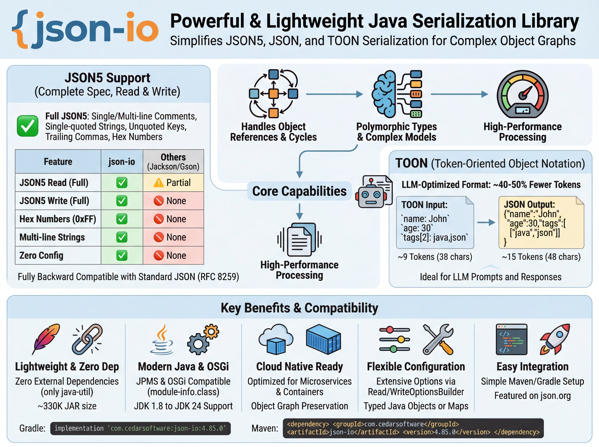

<p align="center">
  
</p>
<p align="right"><sub>Infographic by <a href="https://github.com/glaforge">Guillaume Laforge</a></sub></p>

<div align="center">
  <p>
    <a href="https://central.sonatype.com/search?q=json-io&namespace=com.cedarsoftware">
      
    </a>
    <a href="http://www.javadoc.io/doc/com.cedarsoftware/json-io">
      
    </a>
    <a href="https://github.com/jdereg/json-io/blob/master/LICENSE">
      
    </a>
    
    <a href="https://json5.org/">
      
    </a>
    <a href="https://toonformat.dev/">
      
    </a>
  </p>

  <p>
    <a href="https://github.com/jdereg/json-io">
      
    </a>
    <a href="https://github.com/jdereg/json-io/fork">
      
    </a>
  </p>
</div>

LLM applications waste 40-50% of their token budget on JSON syntax overhead — braces, brackets, quotes, and commas that carry zero semantic information. **json-io** is a Java serialization library that reads and writes **JSON**, **JSON5**, and **[TOON](https://toonformat.dev/)** (Token-Oriented Object Notation) — a format that strips that overhead while preserving full data fidelity. It also handles what Jackson/Gson cannot: cyclic object graphs, automatic polymorphic types, and zero-config serialization of 60+ built-in Java types.

Featured on [json.org](http://json.org) and [Baeldung](https://www.baeldung.com/java-json-toon-format-libraries). See the [interactive JSON vs TOON comparison](https://jdereg.github.io/json-io/compare/).

## Quick Start

```java
// JSON
String json = JsonIo.toJson(myObject);
MyClass obj = JsonIo.toJava(json).asClass(MyClass.class);

// JSON5
String json5 = JsonIo.toJson(myObject, new WriteOptionsBuilder().json5().build());

// TOON (~40-50% fewer tokens than JSON)
String toon = JsonIo.toToon(myObject);
MyClass obj = JsonIo.fromToon(toon).asClass(MyClass.class);

// Standard JSON (Jackson-compatible output — no @type, no @id/@ref, stringified map keys)
String json = JsonIo.toJson(myObject, new WriteOptionsBuilder().standardJson().build());
```

## Installation

**Gradle**
```groovy
implementation 'com.cedarsoftware:json-io:4.116.0'
```

**Maven**
```xml
<dependency>
  <groupId>com.cedarsoftware</groupId>
  <artifactId>json-io</artifactId>
  <version>4.116.0</version>
</dependency>
```

Latest version: [](https://central.sonatype.com/artifact/com.cedarsoftware/json-io)

> **Upgrading to 4.113.0: smaller default JSON.** The default type info (`showTypeInfoMinimal()`) no longer writes
> `@type` on a List, Set or Map whose class is the one the reader builds for its declared type: an `ArrayList` in a
> `List` field is `[...]`, not `{"@type":"ArrayList","@items":[...]}`. That is about half the JSON of a typical graph
> of DTOs, and it still reads back exactly. **A json-io reader older than 4.88.0 reads such elements back as maps,
> without an error.** If your JSON is read by an older json-io, or must stay byte for byte what it was (it is hashed
> or compared), write it with `showTypeInfoMinimalLegacy()`. `showTypeInfoMinimalPlus()` is smaller still where values
> sit in `Object` slots, and lossy there: an `int` in a `Map<String, Object>` reads back as a `Long`.
> Everything else in 4.113.0 that can change a result is in the "Upgrading from 4.112.0" table at the top of the
> [changelog](changelog.md).

---

<details>
<summary><strong style="font-size:1.4em">JSON</strong></summary>

### Usage

```java
// Write JSON
String json = JsonIo.toJson(myObject);
JsonIo.toJson(outputStream, myObject, writeOptions);

// Read JSON to typed Java objects
Employee emp = JsonIo.toJava(json).asClass(Employee.class);
Employee emp = JsonIo.toJava(inputStream, readOptions).asClass(Employee.class);

// Read JSON to Maps (no classes needed)
Map map = JsonIo.toMaps(json).asMap();

// Generic types
List<Employee> list = JsonIo.toJava(json).asType(new TypeHolder<List<Employee>>(){});
```

### Standard JSON Mode — Jackson Compatible

**One flag flips json-io's output to match Jackson.** Use `standardJson()` to produce output
byte-compatible with what Jackson (with `JavaTimeModule` and the Spring Boot default of
`WRITE_DATES_AS_TIMESTAMPS=false`) produces:

```java
WriteOptions opts = new WriteOptionsBuilder()
        .standardJson()    // will be the default in 5.0.0 — this call becomes optional
        .build();
String json = JsonIo.toJson(myObject, opts);
```

This configures: `showTypeInfoNever`, `showRootTypeInfo(false)`, `cycleSupport(false)`,
`stringifyMapKeys(true)`, `writeOptionalAsObject(false)`, `preserveLeafContainerIdentity(false)`,
`isoDateFormat()` (ISO-8601 dates for `java.util.Date` — `java.time.*` are already ISO-8601),
and `useMetaPrefixDollar()`.

**Use json-io anywhere you'd use Jackson** for standard JSON output, and get the full json-io
feature set whenever you need it: cyclic graph preservation, polymorphic `@type` auto-detection,
and first-class **JSON5** + **TOON** output — all from the same builder.

**Need Jackson-style output *plus* graph fidelity?** If your data has shared references or cycles
and you want them preserved (something Jackson only does with `@JsonIdentityInfo` annotated on
every affected class), turn cycle support back on after `standardJson()`:

```java
WriteOptions opts = new WriteOptionsBuilder()
        .standardJson()
        .cycleSupport(true)    // Jackson-compatible output, but $id/$ref are emitted when shared refs exist
        .build();
```

You get Jackson-compatible field names, ISO-8601 dates, and stringified Map keys — **plus** json-io's
automatic shared-reference and cycle preservation. No class annotations required.

### json-io vs Jackson vs Gson

**Object graph handling**

| Capability | json-io | Jackson | Gson |
|------------|---------|---------|------|
| Cyclic object graphs | Automatic (`$id`/`$ref`) -or- `JsonIoException` with `cycleSupport(false)` | Requires `@JsonIdentityInfo` | `StackOverflowError` |
| Shared object references | Preserved (`$id`/`$ref`) -or- duplicated with `cycleSupport(false)` | Requires `@JsonIdentityInfo` | Duplicated (no identity) |
| Polymorphic types | Automatic -or- use `@IoTypeInfo`/`@JsonTypeInfo` | Requires `@JsonTypeInfo` | Requires `TypeAdapter` |
| Unknown `$type` values | Graceful fallback to `Map` | Exception | Exception |

**JDK types**

| Capability | json-io | Jackson | Gson |
|------------|---------|---------|------|
| JDK values read back intact ([104 surveyed](/user-guide.md#jdk-types-compared-with-jackson)) | 100 on JDK 21 and on JDK 8 | 84 (2.22 with modules, and 3.1) | Not surveyed |
| `AtomicReferenceArray`, `AtomicMarkableReference`, `AtomicStampedReference` | Read back on every JDK (8–25), shared and cyclic references kept | `AtomicReferenceArray` cannot be written (2.x) or read back (3.x); the other two cannot be read back | Read back on JDK 8 and 11; cannot be written on JDK 17+ |
| `Pattern` flags (`CASE_INSENSITIVE`) | Kept, written inline (`"(?i)a+b"`) | Lost | Kept on JDK 8; lost on JDK 11; cannot be written on JDK 17+ |

**Map handling**

| Capability | json-io | Jackson | Gson |
|------------|---------|---------|------|
| `Map<String, V>` | Standard JSON object | Same | Same |
| `Map<Long, V>`, `Map<UUID, V>` | `stringifyMapKeys` → `{"100": v}` | `toString()` (fragile) | `enableComplexMapKeySerialization()` |
| `Map<POJO, V>` (complex keys) | Full fidelity via `$keys`/`$items` | `toString()` (lossy) | Array of key-value pairs |

**Format & configuration**

| Capability | json-io | Jackson | Gson |
|------------|---------|---------|------|
| Standard JSON output | `.standardJson()` — Jackson-compatible | Default | Default |
| JSON5 support | Full read/write (native) | Partial read only | None |
| TOON support | Full read/write (40-50% fewer tokens) | None | None |
| Configuration | Zero-config; optional `@Io*` | Annotation-heavy (`@Json*`) | Annotations + builders |
| Jackson annotations | Recognized reflectively (v2 & v3) | Native | Not supported |
| Two parse modes | `toJava()` (typed) + `toMaps()` | Typed only | Typed only |

**Runtime**

| Capability | json-io | Jackson | Gson |
|------------|---------|---------|------|
| Performance (simple DTOs) | 1.3–1.6x vs Jackson (all paths under 2x) | Fastest | 1.5–2.2x vs Jackson |
| Dependencies | java-util only (~850K) | Multiple JARs (~2.5MB+) | Single JAR (~300KB) |
| Java version | JDK 1.8+ | JDK 1.8+ | JDK 1.8+ |

**On performance:** Jackson is faster for simple DTOs, but json-io stays **under 2x Jackson on every read/write mode** on the `JsonPerformanceTest` benchmark (100,000 iterations, diverse POJO workload — nested collections, floats, `BigDecimal`, `java.time.*`, UUIDs, nullable fields). json-io **beats Gson on every write mode** and on `toMaps` reads; on typed reads it takes about 7% longer than Gson. In real-world applications, serialization is typically <1% of total request time — the rest is network I/O, database queries, and business logic. json-io's additional capabilities (cycles, polymorphism, zero-config, JSON5, TOON) often matter more than raw serialization throughput.

**Measured ratios vs Jackson** (lower is faster; 1.0 = Jackson parity):

| Mode | JsonIo | TOON | Gson |
|---|---|---|---|
| Read `toJava` (typed) | 1.59x | 1.54x | 1.48x |
| Read `toMaps` (class-independent) | 1.28x | 1.35x | 1.47x |
| Write `cycleSupport=true` (default) | 1.54x | 1.48x | 2.15x |
| Write `cycleSupport=false` (DTOs/acyclic) | 1.39x | 1.37x | 2.15x |
| Write `toMaps` `cycleSupport=true` | 1.52x | 1.50x | 2.10x |
| Write `toMaps` `cycleSupport=false` | 1.36x | 1.37x | 2.10x |

Measured on JDK 21 (21.0.12), `json-io 4.114.0` vs `jackson-databind 2.22.3` and `gson 2.14.0`, using the median of three run-mode executions. Reproduce with `mvn -q -pl json-io -DskipTests test-compile exec:java -Dexec.classpathScope=test -Dexec.mainClass=com.cedarsoftware.io.JsonPerformanceTest -Dexec.args="--with-gson"` (100k iterations after 10k warmup; expect ±3% run-to-run noise from thermal / GC). All three libraries serialize comparable JSON: Jackson is configured with `JavaTimeModule` and `WRITE_DATES_AS_TIMESTAMPS=false` to match Spring Boot's default; Gson uses ISO-8601 `TypeAdapter`s for `Instant`, `LocalDate`, `LocalDateTime`, and `ZonedDateTime` to match. The `--with-gson` flag is opt-in so the default test run isn't slowed by the Gson loops; drop the flag for the two-way (jsonio vs Jackson) comparison.

**Performance tip:** Use `cycleSupport(false)` for ~10% faster writes when your data is acyclic (DTOs, POJOs, tree-shaped data) — 9–10% for typed objects and in `toMaps` mode on this benchmark.

**Performance tip — reuse `ReadOptions` and `WriteOptions`; they are thread-safe.** `ReadOptionsBuilder.build()` and `WriteOptionsBuilder.build()` take well under a microsecond (the permanent class settings are shared, not copied), but each new options object works out what it needs about each class it meets, once — so it pays to reuse one. The returned options object is **immutable and thread-safe**: build it once per application (or per logical configuration), hold the reference, and share it freely across threads and across calls. The library already caches the common default singletons internally (`ReadOptionsBuilder.getDefaultReadOptions()`, `WriteOptionsBuilder.getDefaultWriteOptions()`), so passing `null` is fine; only custom-configured options need to be built and cached by you.

```java
// Build once at startup
private static final WriteOptions WRITE_OPTS = new WriteOptionsBuilder()
        .standardJson()
        .cycleSupport(false)
        .build();
private static final ReadOptions READ_OPTS = new ReadOptionsBuilder()
        .aliasTypeName("com.example.OldClass", "com.example.NewClass")
        .build();

// Reuse across every call — safe from any thread
String json = JsonIo.toJson(obj, WRITE_OPTS);
MyType result = JsonIo.toJava(json, READ_OPTS).asClass(MyType.class);
```

### Key Features

- **Jackson-compatible standard JSON** — `writeOptions.standardJson()` matches Spring Boot's default Jackson output (ISO-8601 dates, stringified Map keys, no proprietary metadata). Drop-in for Jackson.
- **Jackson-shaped streaming API (since 4.103.0)** — `JsonIo.createGenerator(...)` / `JsonIo.createTokenizer(...)` expose cursor-style read/write that mirrors Jackson's `JsonGenerator` / `JsonParser` method-for-method. Hand-roll large-document or transform pipelines without building an in-memory tree. Included in [fabien renaud's java-json-benchmark](https://github.com/fabienrenaud/java-json-benchmark) `stream` comparison alongside Jackson, Gson, Jakarta-JSON, and others. See the [Streaming API](#streaming-api-jackson-compatible-cursor) section below.
- Two modes: typed Java objects (`toJava()`) or class-independent Maps (`toMaps()`)
- Preserves object references and handles cyclic relationships via `$id`/`$ref` — zero annotations required (Jackson needs `@JsonIdentityInfo` on every class)
- Supports polymorphic types and complex object graphs
- Zero external dependencies (other than java-util)
- Stringify-able map keys: `Map<Long, V>` writes `{"100": value}` with `stringifyMapKeys(true)`
- Extensive configuration via `ReadOptionsBuilder` and `WriteOptionsBuilder`
- Parse JSON with unknown `$type` references into a Map-of-Maps without requiring classes on classpath

</details>

<details>
<summary><strong style="font-size:1.4em">JSON5</strong></summary>

[JSON5](https://json5.org/) is an extension to JSON that makes it more human-friendly. json-io provides **complete JSON5 support** for both reading and writing — the only major Java JSON library to do so natively.

### Reading JSON5

json-io accepts all JSON5 extensions by default — no configuration needed:

```java
String json5 = "{ name: 'John', age: 30, /* comment */ }";
Person p = JsonIo.toJava(json5).asClass(Person.class);
```

Supported: single-line (`//`) and multi-line (`/* */`) comments, single-quoted strings, unquoted keys, trailing commas, hex integers, `Infinity`/`NaN`/`-Infinity`, and more.

### Writing JSON5

```java
WriteOptions opts = new WriteOptionsBuilder().json5().build();
String json5 = JsonIo.toJson(myObject, opts);
```

The `json5()` umbrella enables:
- **Unquoted keys** — object keys that are valid identifiers are written without quotes
- **Smart quotes** — strings containing `"` (but not `'`) use single quotes
- **Infinity/NaN literals** — special float/double values as literals instead of `null`
- **Stringify map keys** — `Map<Long, V>` writes `{100: value}` instead of `$keys`/`$items`
- **No type info** — `showTypeInfoNever()` + `cycleSupport(false)` for clean output

Individual features can be enabled separately. See the [User Guide](/user-guide.md#json5-support) for details.

</details>

<details>
<summary><strong style="font-size:1.4em">TOON</strong></summary>

[TOON](https://toonformat.dev/) (Token-Oriented Object Notation) is an indentation-based format that produces **~40-50% fewer tokens** than JSON — ideal for LLM applications where token count directly impacts cost and context window usage.

- **No braces, brackets, or commas** — structure is expressed through indentation
- **No quoting** for most keys and values — quotes only when needed
- **Compact arrays** — inline `[N]: a,b,c` or list format with `- ` prefixed elements
- **Tabular format** — arrays of uniform objects as CSV-like rows with column headers
- **Key folding** — nested keys like `address.city: Denver` flatten one level of nesting
- **Full fidelity** — most data requires no extra metadata at all
- **TOON v4.4 spec-conformant** — passes all 564 cases of the official fixture suite (encode + decode, strict and non-strict)

**JSON:**
```json
{"team":"Rockets","players":[{"name":"John","age":30,"position":"guard"},{"name":"Sue","age":27,"position":"forward"},{"name":"Mike","age":32,"position":"center"}]}
```

**TOON (same data, ~45% fewer tokens):**
```yaml
team: Rockets
players:
  name, age, position
  John, 30, guard
  Sue, 27, forward
  Mike, 32, center
```

### Usage

```java
// Write TOON
String toon = JsonIo.toToon(myObject);

// Read TOON back to typed Java object
Person p = JsonIo.fromToon(toon).asClass(Person.class);

// Read TOON to Maps (no class needed)
Map map = JsonIo.fromToon(toon).asMap();
```

Request TOON format for LLM applications: `Accept: application/vnd.toon`

See the [Baeldung tutorial](https://www.baeldung.com/java-json-toon-format-libraries) for a walkthrough of JSON, JSON5, and TOON serialization with json-io, and the [interactive JSON vs TOON comparison](https://jdereg.github.io/json-io/compare/).

### vs JToon

| Capability | json-io | JToon |
|---|---|---|
| Built-in types | 60+ | ~15 |
| Map key types | Any serializable type | Strings only |
| EnumSet support | Yes | No |
| Full Java serialization | Yes — any object graph | Limited to supported types |
| Cycle support (`$id`/`$ref`) | Yes (opt-in) | No |
| Annotation support | `@Io*` + Jackson (reflective) | None |
| Dependencies | java-util only | Jackson |
| Status | Stable, production-ready | Beta (v1.x.x) |

</details>

<details>
<summary><strong style="font-size:1.4em">Spring Boot Integration</strong></summary>

json-io provides a Spring Boot starter for seamless integration with Spring MVC and WebFlux applications.

**Standalone or with Spring — your choice.** json-io's core has no Spring dependency (its only runtime dependency is `java-util`), so it works anywhere. The Spring Boot starter is an optional, non-intrusive add-on: it declares Spring as **`provided`**, so it plugs into *your* application's own Spring and forces **no** Spring version onto your build — your Boot version always wins, and adding the starter puts nothing on your classpath but `json-io` itself. **Works on Spring Boot 3.x and 4.x** — the shipped starter uses only Spring Framework-level APIs (no Boot-version-specific types), so one artifact runs on both majors: compiled against a Spring Boot 3.4 (Spring 6.2) *floor*, forward-tested across Boot 3.x, and runtime-verified on Spring Boot 4.1 / Spring 7 (auto-configuration, HTTP message converters, and reactive codecs).

```xml
<dependency>
  <groupId>com.cedarsoftware</groupId>
  <artifactId>json-io-spring-boot-starter</artifactId>
  <version>4.116.0</version>
</dependency>
```

Your REST controllers now support JSON, JSON5, and TOON formats via content negotiation:

```java
@RestController
public class ApiController {
    @GetMapping("/data")
    public MyData getData() {
        return myData;  // Returns JSON, JSON5, or TOON based on Accept header
    }
}
```

### Spring AI Integration

json-io provides a Spring AI module that reduces LLM token usage by ~40-50% using TOON format for tool call results and structured output parsing.

```xml
<dependency>
  <groupId>com.cedarsoftware</groupId>
  <artifactId>json-io-spring-ai-toon</artifactId>
  <version>4.116.0</version>
</dependency>
```

Auto-configured: tool call results are serialized to TOON automatically. For structured output, use `ToonBeanOutputConverter<T>`:

```java
ToonBeanOutputConverter<Person> converter = new ToonBeanOutputConverter<>(Person.class);
Person person = chatClient.prompt()
    .user("Get info about John")
    .call()
    .entity(converter);
```

**Also supports WebFlux and WebClient** for reactive applications.

See the [Spring Integration Guide](/user-guide-spring.md) for configuration options, WebFlux usage, customizers, and Jackson coexistence modes.

</details>

<details id="streaming-api-jackson-compatible-cursor">
<summary><strong style="font-size:1.4em">Streaming API (Jackson-compatible cursor)</strong></summary>

Since 4.103.0, json-io exposes **`JsonGenerator`** and **`JsonTokenizer`** — cursor-style streaming write/read surfaces shaped method-for-method against Jackson's `com.fasterxml.jackson.core.JsonGenerator` / `JsonParser`. These bypass the tree-builder entirely: no `JsonObject` graph is built on read, no reflection is invoked on write.

### Streaming write

```java
try (JsonGenerator g = JsonIo.createGenerator(outputStream)) {
    g.writeStartObject()
        .writeStringField("id", "u-1")
        .writeStringField("name", "Alice")
        .writeArrayFieldStart("tags")
            .writeString("admin").writeString("active")
        .writeEndArray()
        .writeNumberField("age", 30)
     .writeEndObject();
}
```

Factories: `createGenerator(Writer)`, `createGenerator(OutputStream)`, plus `WriteOptions`-aware overloads. Honors `prettyPrint`, `indentationSize`, `json5UnquotedKeys`, `json5SmartQuotes`, `allowNanAndInfinity`, and `maxStringLength` from the supplied options.

### Streaming read

```java
try (JsonTokenizer t = JsonIo.createTokenizer(jsonString)) {
    while (t.nextToken() != null) {
        switch (t.currentToken()) {
            case FIELD_NAME:         String name = t.currentName();    break;
            case VALUE_STRING:       String text = t.getText();        break;
            case VALUE_NUMBER_INT:   long   i    = t.getLongValue();   break;
            case VALUE_NUMBER_FLOAT: double f    = t.getDoubleValue(); break;
            // ...
        }
    }
}
```

Factories: `createTokenizer(String)`, `createTokenizer(InputStream)`, plus `ReadOptions`-aware overloads. Honors `strictJson`, `allowNanAndInfinity`, `integerTypeBigInteger`, `floatingPointBigDecimal`, and `stringBufferSize`.

### Splice streaming read into streaming write

```java
try (JsonTokenizer t = JsonIo.createTokenizer(input);
     JsonGenerator g = JsonIo.createGenerator(out)) {
    while (t.nextToken() != null) {
        g.copyCurrentEvent(t);          // single token
    }
}
```

`copyCurrentStructure(tokenizer)` copies the current value plus all of its children (scalar, full object, or full array) for higher-level parse-transform-emit pipelines.

### When streaming vs tree

| Use case | API |
|---|---|
| Cycle-bearing graphs, full type fidelity, `@id` / `@ref` / custom readers / custom writers | `JsonIo.toJava` / `toJson` (tree, default) |
| Very large documents (avoid an in-memory `JsonObject` tree) | `JsonGenerator` / `JsonTokenizer` |
| Pass-through transform / re-emit pipelines | `copyCurrentEvent` / `copyCurrentStructure` |
| Direct port from Jackson `JsonGenerator` / `JsonParser` code | Streaming API — same shape, same call sites |

### Benchmarked alongside Jackson, Gson, Jakarta-JSON

json-io is wired into [fabien renaud's java-json-benchmark](https://github.com/fabienrenaud/java-json-benchmark) `stream` comparison — a JMH suite that hand-rolls each library's tokenizer/generator method-for-method against the same model. The json-io entry uses `JsonTokenizer` for read and `JsonGenerator` for write, with the same shape as the Jackson entry it sits next to. This makes the comparison apples-to-apples: no databind, no reflection, no pre-built trees on either side.

### Exception conventions

Streaming-API methods declare `IOException` (Jackson convention). Two checked subtypes carry the structural / lexical detail:
- `JsonParseException` — malformed JSON or wrong-token-type accessor calls (`getBooleanValue()` on a number, etc.)
- `JsonGenerationException` — structural misuse (`writeFieldName` outside an object, mismatched `writeEndArray`, value without a field name, etc.)

Both extend `IOException` and are transparently caught by existing `catch (IOException e)` blocks. The tree-API (`JsonIo.toJava` / `toJson`) continues to use the unchecked `JsonIoException`.

See the [Streaming API section of the User Guide](/user-guide.md#streaming-api-cursor-style-readwrite) for full details, the custom-reader/-writer migration path, and binary (`byte[]`) handling.

</details>

<details>
<summary><strong style="font-size:1.4em">Annotations, Types &amp; Configuration</strong></summary>

### Annotation Support

json-io provides 25 annotations in the `com.cedarsoftware.io.annotation` package for controlling serialization and deserialization:

| Annotation | Target | Purpose |
|---|---|---|
| `@IoProperty("name")` | Field | Rename field in JSON |
| `@IoIgnore` | Field | Exclude field |
| `@IoIgnoreProperties({"a","b"})` | Class | Exclude fields by name |
| `@IoAlias({"alt1","alt2"})` | Field | Accept alternate names on read |
| `@IoPropertyOrder({"x","y"})` | Class | Control field order on write |
| `@IoInclude(Include.NON_NULL)` | Field | Skip null on write |
| `@IoCreator` | Constructor/Method | Custom deserialization constructor or static factory |
| `@IoValue` | Method | Single-value serialization |
| `@IoNaming(Strategy.SNAKE_CASE)` | Class | Naming strategy for all fields |
| `@IoIncludeProperties({"a","b"})` | Class | Whitelist of included fields |
| `@IoIgnoreType` | Class | Exclude all fields of this type everywhere |
| `@IoTypeInfo(LinkedList.class)` | Field | Default concrete type when `$type` absent; also eliminates `$type` on write when runtime type matches |
| `@IoDeserialize(as=LinkedList.class)` | Field/Class | Force type override during deserialization; also eliminates `$type` on write when runtime type matches |
| `@IoClassFactory(MyFactory.class)` | Class | Specify a ClassFactory for deserialization |
| `@IoGetter("fieldName")` | Method | Custom getter method for serialization |
| `@IoSetter("fieldName")` | Method | Custom setter method for deserialization |
| `@IoNonReferenceable` | Class | Suppress `$id`/`$ref` for instances of this type |
| `@IoNotCustomReader` | Class | Suppress custom reader (use standard deserialization) |
| `@IoNotCustomWritten` | Class | Suppress custom writer (use standard serialization) |
| `@IoCustomWriter(MyWriter.class)` | Class | Specify custom `JsonClassWriter` for serialization |
| `@IoCustomReader(MyReader.class)` | Class | Specify custom `JsonClassReader` for deserialization |
| `@IoTypeName("ShortName")` | Class | Alias for `$type` in JSON (replaces FQCN) |
| `@IoAnySetter` | Method | Receive unrecognized JSON fields during deserialization |
| `@IoAnyGetter` | Method | Provide extra fields during serialization |
| `@IoFormat("pattern")` | Field | Per-field format pattern (`String.format`, `DecimalFormat`, `DateTimeFormatter`, or `SimpleDateFormat`) |

Additionally, json-io **reflectively honors Jackson annotations** when they are on the classpath — with zero compile-time dependency on Jackson. Supported: `@JsonProperty`, `@JsonIgnore`, `@JsonIgnoreProperties`, `@JsonAlias`, `@JsonPropertyOrder`, `@JsonInclude`, `@JsonCreator`, `@JsonValue`, `@JsonIgnoreType`, `@JsonTypeInfo`, `@JsonIncludeProperties`, `@JsonNaming`, `@JsonDeserialize`, `@JsonGetter`, `@JsonSetter`, `@JsonTypeName`, `@JsonFormat`, `@JsonAnySetter`, `@JsonAnyGetter`.

Both **Jackson 2.x and 3.x** are recognized: the `com.fasterxml.jackson.annotation.*` annotations are shared across both majors (Jackson 3.x reuses the 2.x annotations jar), while the two databind annotations that changed packages in 3.x — `@JsonNaming` and `@JsonDeserialize` — are detected under both `com.fasterxml.jackson.databind.annotation.*` (2.x) and `tools.jackson.databind.annotation.*` (3.x).

**Precedence:** Programmatic API > json-io annotations > Jackson annotations.

See the [Annotations section of the User Guide](/user-guide.md#annotations) for full details and examples.

### Supported Types (60+ built-in)

json-io handles your **business objects, DTOs, and Records** automatically—no annotations required. It also provides optimized handling for these built-in types:

| Category | Types |
|----------|-------|
| Primitives | `byte`, `short`, `int`, `long`, `float`, `double`, `boolean`, `char` + wrappers |
| Numbers | `BigInteger`, `BigDecimal`, `AtomicInteger`, `AtomicLong`, `AtomicBoolean`, `LongAdder`, `DoubleAdder` |
| Atomic holders | `AtomicReference`, `AtomicReferenceArray`, `AtomicMarkableReference`, `AtomicStampedReference`, `AtomicIntegerArray`, `AtomicLongArray` |
| Date/Time | `Date`, `Calendar`, `Instant`, `LocalDate`, `LocalTime`, `LocalDateTime`, `ZonedDateTime`, `OffsetDateTime`, `OffsetTime`, `Duration`, `Period`, `Year`, `YearMonth`, `MonthDay`, `TimeZone`, `ZoneId`, `ZoneOffset`, `java.sql.Date`, `java.sql.Time`, `Timestamp` |
| Strings | `String`, `StringBuffer`, `StringBuilder`, `char[]`, `CharBuffer` |
| Binary | `byte[]`, `ByteBuffer`, `BitSet` |
| IDs | `UUID`, `URI`, `URL`, `Class`, `Locale`, `Currency`, `Pattern`, `File`, `Path`, `InetAddress` |
| Geometric | `Color`, `Dimension`, `Point`, `Rectangle`, `Insets` |
| Other | `Enum` (any), `Throwable`, all `Collection`, `Map`, `EnumSet`, `EnumMap`, and array types |

See [JDK types compared with Jackson](/user-guide.md#jdk-types-compared-with-jackson): of 104 JDK values written and read back, json-io keeps 100 intact on JDK 21 and on JDK 8, Jackson 84.
See the [complete type comparison](/user-guide.md#toon-supported-types) showing json-io's comprehensive support vs other TOON implementations.

### Key Features

- Fully compatible with both JPMS and OSGi environments
- Zero external dependencies (other than java-util)
- Lightweight (`json-io.jar` is ~570K, `java-util` is ~850K — total ~1420K)
- Compatible with JDK 1.8+
- Built with `-parameters` so reflection sees real parameter names (used for constructor discovery, etc.)
- Optional unsafe mode for deserializing package-private classes, inner classes, and classes without accessible constructors (opt-in for security)
- Extensive configuration options via `ReadOptionsBuilder` and `WriteOptionsBuilder`

</details>

## Documentation

- [User Guide](/user-guide.md)
- [WriteOptions Reference](/user-guide-writeOptions.md)
- [ReadOptions Reference](/user-guide-readOptions.md)
- [Spring Integration Guide](/user-guide-spring.md)
- [Revision History](/changelog.md)

**Articles & Tutorials**
- [JSON, TOON, and Java Format Libraries](https://www.baeldung.com/java-json-toon-format-libraries) — Baeldung tutorial covering JSON, JSON5, and TOON serialization with json-io

## Release [](https://central.sonatype.com/artifact/com.cedarsoftware/json-io)

| | |
|---|---|
| **Bundling** | JPMS & OSGi |
| **Java** | JDK 1.8+ (multi-release JAR with module-info.class) |
| **Package** | com.cedarsoftware.io |

**API** — Static methods on [JsonIo](/json-io/src/main/java/com/cedarsoftware/io/JsonIo.java): `toJson()`, `toJava()`, `toMaps()`, `toToon()`, `fromToon()`, `formatJson()`, `deepCopy()`

Configure via [ReadOptionsBuilder](/user-guide-readOptions.md) and [WriteOptionsBuilder](/user-guide-writeOptions.md). Use [ClassFactory](/json-io/src/main/java/com/cedarsoftware/io/ClassFactory.java) for difficult-to-instantiate classes.

### Logging

json-io uses `java.util.logging` to minimize dependencies. See the [user guide](/user-guide.md#redirecting-javautillogging) to route logs to SLF4J or Log4j 2.

---

For useful Java utilities, check out [java-util](http://github.com/jdereg/java-util)
